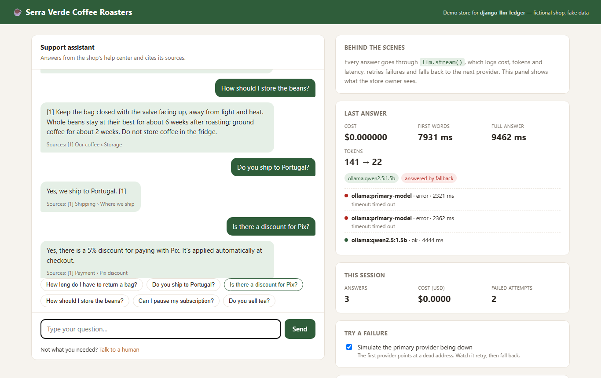
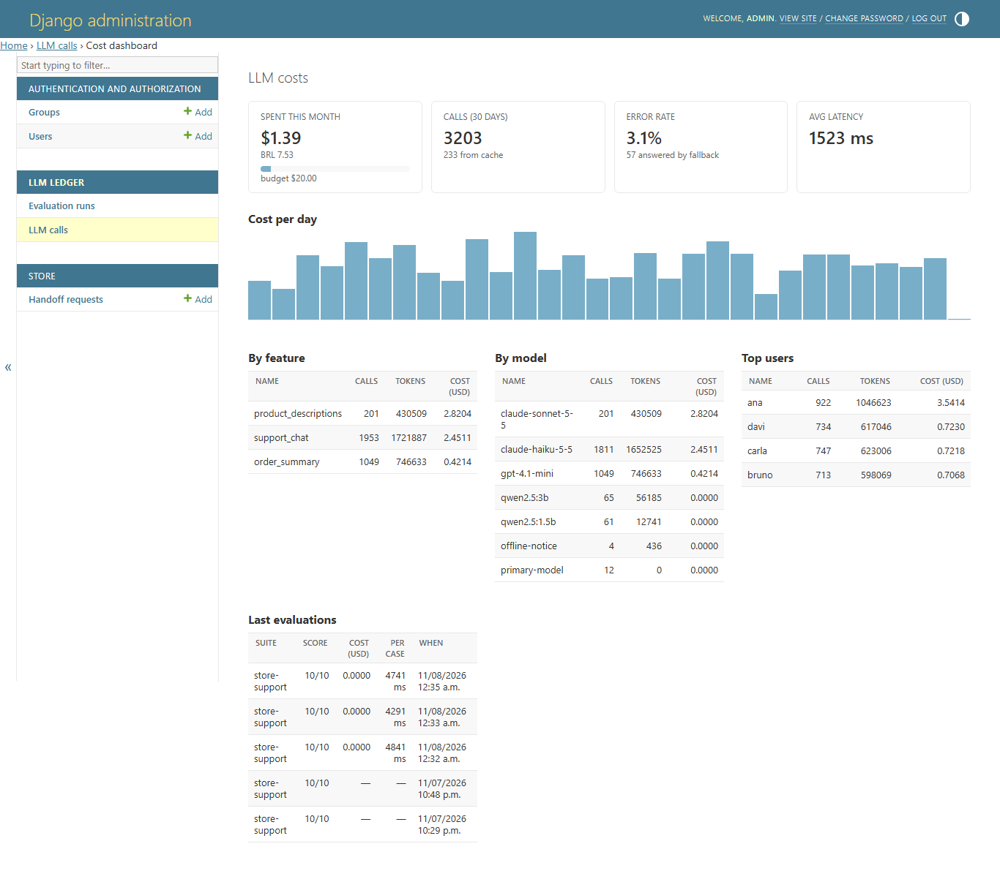

# django-llm-ledger

Know what your LLM features cost, keep them working when a provider goes down, and catch prompt regressions in CI.

Most teams that "added AI to the product" find out three things later: nobody knows what it costs per feature, it breaks when the API has a bad day, and nobody can tell whether yesterday's prompt tweak made answers worse. `django-llm-ledger` is a small Django app that handles all three without changing how you write your feature.

```python
from llm_ledger import llm

answer = llm.complete(
    "Summarize this order for the customer: ...",
    feature="order_summary",   # cost is tracked per feature
    user=request.user,          # ...and per user
)
print(answer.text, answer.cost_usd, answer.latency_ms)
```






## What you get

- **A ledger of every call**: provider, model, tokens, cost, latency, status, feature and user. Prompts are **not** stored unless you opt in, since they often carry personal data.
- **A cost dashboard in the Django admin**: spend this month vs. budget, cost per day, top features, models and users, error rate, fallback count.
- **Retries and fallback**: retryable errors (timeouts, 429, 5xx) are retried with exponential backoff; then the next provider in the chain takes over. Put a local model last and your feature keeps answering even when the paid API is down.
- **Streaming**: `llm.stream()` yields the answer as it is written, with the same ledger, cache, retries and fallback.
- **Async views**: `await llm.acomplete()` and `await llm.astream()`.
- **Cache**: identical requests are served from Django's cache and cost nothing.
- **Budget guard**: a monthly budget for the whole app and, optionally, one per feature. A `budget_exceeded` signal when one is reached, and optional hard blocking that only stops the feature over its limit.
- **Evaluation suites**: a file of questions plus what a good answer must (not) contain. `manage.py llm_evaluate` scores them and fails your CI when the score drops.
- **No vendor SDKs**: Ollama, OpenAI-compatible servers (OpenAI, LM Studio, vLLM, Groq...) and Anthropic over plain HTTP. Only dependency besides Django is `httpx`.

## Install

```bash
pip install django-llm-ledger          # add [yaml] for YAML suites
```

```python
INSTALLED_APPS = [..., "llm_ledger"]

LLM_LEDGER = {
    # Tried in order. The first one that answers wins.
    "PROVIDERS": [
        {"name": "anthropic", "model": "claude-sonnet-5-5"},          # key from ANTHROPIC_API_KEY
        {"name": "openai", "model": "gpt-4.1-mini"},                   # key from OPENAI_API_KEY
        {"name": "ollama", "model": "llama3.2"},                       # local, free, last resort
    ],
    # USD per 1M tokens. Not shipped on purpose: prices change, and stale prices lie quietly.
    "PRICES": {
        "claude-sonnet-5-5": {"input": 3.0, "output": 15.0},
        "gpt-4.1-mini": {"input": 0.4, "output": 1.6},
    },
    "MONTHLY_BUDGET_USD": 50,
    "LOCAL_CURRENCY": {"code": "BRL", "rate": 5.4},   # optional second currency in the dashboard
}
```

```bash
python manage.py migrate
```

The dashboard lives at **Admin → LLM calls → Cost dashboard**.

> The prices above are placeholders for the example. Check your provider's pricing page.

## Settings

| Key | Default | |
|---|---|---|
| `PROVIDERS` | `[{"name": "ollama", "model": "llama3.2"}]` | Fallback chain. `name` is `ollama`, `openai`, `anthropic`, `fake` or a dotted path to your own `Provider` subclass. Extra keys (`base_url`, `api_key`, `api_key_env`, `price`, `timeout`) go to the provider. |
| `PRICES` | `{}` | USD per 1M tokens, per model. Paid calls without a price are recorded with `cost_usd=None` and flagged in the dashboard. |
| `MAX_RETRIES` | `2` | Retries per provider for retryable errors. |
| `RETRY_BACKOFF` | `0.5` | Base delay in seconds; doubles on each retry. |
| `TIMEOUT` | `60` | HTTP timeout in seconds. |
| `CACHE_TTL` | `3600` | Seconds to cache identical requests. `0` disables. |
| `CACHE_ALIAS` | `"default"` | Which Django cache to use. |
| `MONTHLY_BUDGET_USD` | `None` | Sends `budget_exceeded` when reached. |
| `FEATURE_BUDGETS_USD` | `{}` | Monthly limit per feature, e.g. `{"support_chat": 20}`. Shown in the dashboard; a bar turns amber at 80%. |
| `BLOCK_OVER_BUDGET` | `False` | Raise `BudgetExceeded` instead of just signalling. With feature budgets, only the feature over its limit is blocked. |
| `LOCAL_CURRENCY` | `None` | `{"code": "BRL", "rate": 5.4}` to show a second currency. |
| `STORE_PROMPTS` | `False` | Store prompt and response text in the ledger. |

## Evaluation suites

```yaml
# evals/support.yaml
name: support
system: "You answer for ACME Store. Returns are accepted within 30 days."
cases:
  - id: return-window
    input: "How long do I have to return an item?"
    must_contain: ["30 days"]
  - id: no-made-up-promises
    input: "Can I return a used mattress after a year?"
    must_not_contain: ["yes, of course"]
  - id: shipping
    input: "Do you ship to Brazil?"
    any_of: ["yes", "we ship"]
```

To test your real feature (retrieval, tools, post-processing) instead of a raw prompt, point the suite at a function:

```yaml
target: shop.ai.answer_customer   # called as answer_customer(input) -> str
```

```bash
python manage.py llm_evaluate evals/ --min-score 0.9
```

```text
store-support  (evals/store-support.yaml)
  PASS  return-window
  ...
  score 10/10 = 100%
  cost $0.0042, 3120 tokens, 4120 ms per case
```

To compare models, pin each run to one of them (no fallback) and get a table at the end:

```bash
python manage.py llm_evaluate evals/ --models ollama:qwen2.5:1.5b,ollama:qwen2.5:0.5b
```

```text
Comparison
  model                suite          score  cost (USD)  tokens  ms/case
  -------------------  -------------  -----  ----------  ------  -------
  ollama:qwen2.5:1.5b  store-support  11/11     $0.0000    2093     7244
  ollama:qwen2.5:0.5b  store-support  10/11     $0.0000    2178     6070
```

That is a real run on the demo store: the smaller model was only 16% faster, and it answered
"Yes, we do sell green tea", for a coffee shop that sells no tea. Pinned runs reuse the settings of
the configured provider with the same name (API key, `base_url`, `model_options`), and target
functions are pinned too. Evaluations never use the cache: they measure the model as it answers now.

Each run also adds up what it cost, reading the ledger rows written while each case ran, so it
works for `target` functions that make several calls. Runs are stored and show up in the dashboard
with score, cost and time side by side: swap a model, rerun the suite, compare.

## Streaming

```python
from django.http import StreamingHttpResponse
from llm_ledger import llm

def ask(request):
    stream = llm.stream(request.POST["question"], feature="support", user=request.user)

    def body():
        with stream:          # if the browser leaves, the call is still recorded
            yield from stream
        # stream.result has cost, tokens, latency and first_chunk_ms once it ends

    return StreamingHttpResponse(body(), content_type="text/plain")
```

Retries and fallback only happen **before the first chunk**. Once words have reached the reader,
switching models would glue two different answers together, so a failure after that raises
`LLMError` and the partial text stays in `stream.text`. Budget and cache are checked when you call
`llm.stream()`, so `BudgetExceeded` is raised there, before you start the response. A cache hit
comes back as a single chunk.

Ollama, OpenAI-compatible servers and Anthropic stream natively. A custom provider without a
`stream()` method still works: it yields the whole answer at once.

The demo store streams its chat as newline-delimited JSON (`example/store/views.py`).

## Async views

```python
from django.http import JsonResponse, StreamingHttpResponse
from llm_ledger import llm

async def summary(request):
    result = await llm.acomplete(prompt, feature="summary", user=request.user)
    return JsonResponse({"text": result.text})

async def chat(request):
    stream = await llm.astream(question, feature="chat")   # budget and cache checked here

    async def body():
        async with stream:
            async for chunk in stream:
                yield chunk

    return StreamingHttpResponse(body(), content_type="text/plain")
```

The async methods run the same code as the sync ones through Django's `sync_to_async`: the ledger
is written with the ORM, which is synchronous, and one code path means the two APIs cannot drift
apart. While a provider answers, the event loop stays free and other requests are served. The
test suite checks both: a coroutine keeps running during a slow call, and two concurrent requests
take about as long as one.

## Handling failures in your code

```python
from llm_ledger import LLMError, BudgetExceeded, llm

try:
    answer = llm.complete(question, feature="support")
except BudgetExceeded as exc:
    ...  # e.g. show "the assistant is resting, talk to a human"
         # exc.feature is "support" if it was that feature's budget, None for the global one
except LLMError as exc:
    logger.error("every provider failed: %s", exc.errors)
```

Listen to the budget signal to notify someone:

```python
from django.dispatch import receiver
from llm_ledger.signals import budget_exceeded

@receiver(budget_exceeded)
def warn_team(sender, spent, budget, feature=None, **kwargs):
    ...  # feature is None for the global budget
```

## Demo store

`example/` is a fictional coffee shop with a support chat built on the library. The chat finds the relevant help sections with embeddings from a small local model, answers from them and cites its sources. A side panel shows what each answer cost, which provider served it and every retry. A switch simulates the main provider going down, so you can watch the fallback happen live.

```bash
ollama pull qwen2.5:1.5b            # free local model (~1 GB); set ANTHROPIC_API_KEY to put Claude first
ollama pull all-minilm              # embeddings for the help-center search (46 MB)
cd example
uv run --project .. python manage.py migrate
uv run --project .. python manage.py seed_demo          # 30 days of synthetic history for the dashboard
uv run --project .. python manage.py createsuperuser
uv run --project .. python manage.py runserver
uv run --project .. python manage.py llm_evaluate evals/ --min-score 0.8
```

## Development

```bash
uv sync
uv run pytest
```

## License

MIT
